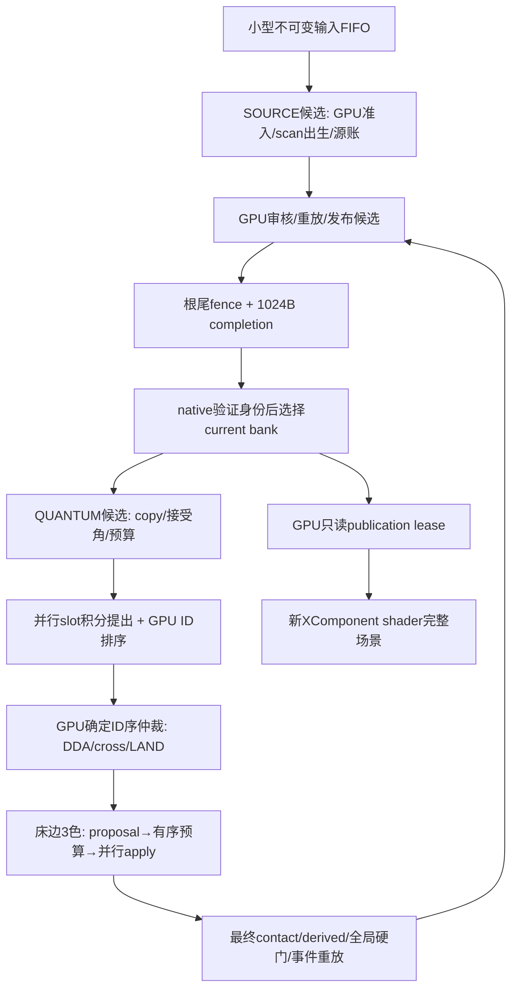

# T230：GPU驻留整步仿真算法 v1

2026-10-28，designer；原卡 `6ae1c798e4b0c3103c116f0a`。目标6、P5、当前最高调度优先。路线 **`gpu-resident-integer-step-v1`**，状态 **DESIGN_READY_FOR_ARCHITECT / NOT_IMPLEMENTED / NOT_VALIDATED**。不使用真机，不改业务/生产开关、不回退共享修改。不允许修改 `D:\hmprojects\HelloWorld\docs\后续工作清单.md`，仅本任务状态有限例外；不改其它行列/队列或滴答同名清单。所有背景/前景只用新XComponent+shader，禁Canvas回退；故障FAULT或显式STALE完整旧新管线帧。manager按交付登记，不加验收门。

消费T197/T205、T211/T212/T213、T142/T161/T199、T207、T221/T222及当前物理/native源码；输入指纹、设计模型、资源算式见 `design-T230-gpu-resident-evidence-v1.json`，候选取舍见独立retro。本稿与T231并行，不等待旧pair桥T224/T225、CPU D2或FP64探针才能设计；平台限制如未获实测，准确记UNKNOWN，不推定通过。

## 1. 定稿与最小可交付闭环

推荐**整数质量/场、定点运动、GPU候选整bank、确定冲突仲裁、GPU生成渲染发布**。首次初始化后权威粒子/床/预算/事件不逐帧回CPU；输入只传命令，成功/失败只读有界completion。CPU旧实现保留作历史行为对照；新整数policy另有独立高精度oracle，不能要求旧F64全轨迹逐位相同，也不能以“新路线”放松守恒/非负/容量/guard/事务硬门。

| 里程碑 | 必须实现的端到端闭环 | 明确unsupported |
| --- | --- | --- |
| **M0，首个可交付原型** | 独立空容器、单H沙、真实source出生→空气积分/DDA碰撞/跨列→LAND→床面邻流→严格审核/重放→整bank接受→同token床沙+粒子shader显示；停止/reset/输入角/故障回执；可接目标3/5的隔离GPU开关 | W/J、L沙、湿阻力、merge、lift、S3/S4/correction、旧run restore；池满明确拒绝。不是旧目标5全语义替换 |
| M1 | 同owner接真W和在途J，水头扩散/沙入水/到达换W/双选源、目标7/8 scene；沿T221时序但整数化 | 未迁移的旧双沙/渗流等仍拒绝配置 |
| M2 | GPU内预算/事件进一步并行、满池动态确定选对/merge、slot/ID/票据全GPU；无逐birth/merge读回 | 未完成的旧channel不偷偷CPU执行 |
| M3 | 双phase、advection/settle/percolation/bottom/deep/relax/correction/lift、原preview/authoritative/source λ的明确新policy移植 | 每个配置通道按实现位图开门；未覆盖写路径拒绝整配置 |

M0已经是真GPU仿真闭环，不是只画移动点或把CPU状态上传GPU。M1/M2/M3是本文给出的后续算法接力范围，未实现不冒覆盖；不要求等全部旧通道迁完再产原型。生产接入要有对应实现、独立、设备及完整DEMO证据，保留旧CPU/raw，切换新run，不后台迁旧run。

## 2. 已知平台事实与假设

T142/T161在Mali B318/GLES3.2实测整数compute、SSBO、11/12 dispatch、尾fence/128B map和修复后pair消费；T199真机全事务旧GPU-pair fixture仍慢于LEGACY，O2未获整事务收益，UI竞争未测。T211/T213证明其限定CPU D1/树桥离线范围；T212仍CPU F64权威＋每find freeze/sort/SHA/upload/fence。**这些都不证明整步驻留、FP64、float原子、跨XComponent共享或本整数核已成立。**

最低算法依赖为highp 32-bit整数、SSBO、compute dispatch和有序跨dispatch可见性；不需float原子、int64原子、native FP64或subgroup。64/128位算术以多uint limb实现，`umulExtended/uaddCarry/usubBorrow`可用但必须设备核证。GLSL ES规定highp整数32位及这些扩展乘法原语；float运算不能直接当IEEE严格oracle。见[Khronos GLSL ES 3.10 §4.1/§8.8](https://registry.khronos.org/OpenGL/specs/es/3.1/GLSL_ES_Specification_3.10.pdf)。这是规范能力，不是本设备新shader已PASS。

host只负责：校验协议长度/owner/generation与资源额度、FIFO、整数时钟quantum调度、EGL/context线程/提交/完成、冷配置和已批准系数表传输、控制bank可见代与scene lease、收集有界completion。**不运行物理积分/guard/配对/预算、每请求全sort/SHA或每帧导出整pool**。输入F64质量/位置位型解码到网格也在GPU；host原始字节协议/单调时钟采集不冒物理准入。

## 3. 数值policy：GRS_Q20_V1

### 3.1 表示、范围和守恒

质量/单位列高度用`Qm=2^20`，一单位`2^-20=0.00000095367431640625`。非负库存为U32：bh/bl/mh/ml/悬沙U_H/U_L/W/J/P_H/P_L，单列总占据≤`Cq=256*Qm=268435456`。M0只bh/mh/P_H可非0，其余存0并审核；M1启W/J。全局各phase质量、I_kind、预算/事件累计用至少U64(two U32)，禁止32位sum wrap。N128全容积为`2^35`质量单位，不会挤入单U32。真实质量界与编码域不同，坏值先拒绝，不能模回绕继续。

位置/速度也Q20整数：x∈[0,128Qm)、y∈[0,256Qm]，速度signed且`abs(v)<=1024Qm`；g≤1024Qm、drag系数A∈[0,Qm]冷定。乘除用符号/幅度分开、U64/U128中间量，溢出先检，不能依赖signed overflow。`mulDivRNE(a,b,d)`定义精确乘积后最近偶数商；质量请求/预算/安全边界取floor或明确ceil，不用RNE把质量变大。8bit flags不放uint8 SSBO布局，按word打包。

**内部转移同一个整数q**：donor−q、receiver＋q；LAND pool−q/mh＋q；ARRIVE J−q/W＋q；CROSS仅换列归属。审核要求逐phase整数总量**精确相等**，water total=W+J，sand=床+U+pool；库存非负、单列容量≤Cq、预算不超、来源/ID不重复均硬拒。因2^-20是dyadic，转换到CPU F64核账时这些支持域总量仍精确，内部绝对误差0满足原1e-6和累计<.001；不是把旧容差改大。

输入requested质量以原binary64两word传入，GPU解码finite/sign/exponent/mantissa，`requestUnits=floor(requested*Qm)`；正值量化为0返回NUMERIC_RESOLUTION_REJECTED、无成功。实际admitted≤requestUnits、余量=原requested−admitted/Qm明确回执，不把量化残差计I，不将旧已准入库存舍去。请求每次残差<一量子仅是量化上界，容量/资源拒绝另计；不得把“每笔少一点”隐入基准。CPU输入对照分别报告offered原值与整数准入，严禁用新较少accepted量冒提速。

旧F64 subnormal任意小库存、±0/NaN payload、RN加减/加权中心、顺序fold、reserve/refund图都不等价于Q20。本route旧snapshot/import拒绝，初始仅新空run或明确标注exact-grid合成fixture；不将T207 exact70-RN dry policy或T221 V2 F64水账偷改为本policy。renderer float只能来自已审核整数state，不能反向回填。

### 3.2 时间、角度与系数

固定物理quantum **h=1/120s**，active frame至多4quantum（最多1/30s），区别旧最多2个可变dt的显式版本 `GRS_FIXED120_TIME_V1`。ADVANCE输入deltaNs整数两word（原时间需可精确表达ns；不合域拒绝），`a=carry+120*deltaNs; F=floor(a/1e9); carry'=a mod 1e9`，F≤4；carry在owner控制事务中单独接收，不是物理source。dt0严格无写。暂停/时钟倒退/超窗清本手势及时间carry、首恢复tick0，不墙钟追赶；量化延期小于1 quantum且记录carry，不丢时间后称等价。0<F时逐quantum独立root提交，第二/后续失败保留已成功quantum，不为失败量补跑。失败未执行的本次量子在失败回执中记failed/discarded duration，不悄悄累入下次；此为新调度语义。

该整数时间切分由native owner**控制面**每ADVANCE一次计算，冻结delta/carryBefore/carryAfter/F/frameSerial为小型输入，GPU每root校版本/该量子ordinal并以固定h推进；不是额外一个GPU物理root，也不为读F多加fence。F0只接收控制carry，physicsCommit/stock无写；dt0连carry不写。carry/已安排量子/成功量子/失败discard时长分别计账，未来cold checkpoint需同时保存这个native控制状态，不能仅保存GPU bank冒完整恢复。它没有按粒子/事件/merge运行CPU物理，normal G1+F4根上界不变。

SOURCE是单独显式root，不藏在dt0里。normal active tick最多一个source root后F个quantum root，G≤1；队列≤16按FIFO，一次不为追赶多源清空16条。源成功后step失败保留源；已生成请求不合并/改ID，背压保留offered分母。源质量仍按真实active raw窗口计算的请求位型入协议，GPU准入，不把120Hz余时变额外源。

角度index `j∈[-7680,7680]`，单位1/256度，冷表每项4个I32`[tanQ20,sinQ20,cosQ20,0]`。表以独立高精度生成/核证后冷上传和SHA绑定，热路不调用GPU sin/cos/exp，未冻结表不启配置。tan采用sign×floor(abs(tan)*Qm)，`Hfloor=floor(tan30*Qm)=605395`，另取**Hq=Hfloor−1=605394**。这一量子是显式保守安全边界，覆盖`abs(u_j/Qm−tan(j/256°))<1/Qm`的表量化误差；严格guard为`abs(S[c+1]-S[c]-u_j)<=Hq`，则相对于真实接受角的物理差 `<(Hq+1)/Qm=Hfloor/Qm<=原tan30`。不能只用Hfloor却忘记接受角表误差、从而在某些角的反向边越原硬门。表冻结还需核其对原CPU tangent/hard-limit位型的误差界；不满足该界则配置不支持。系数表误差、index量化和旧planner不同，须独立数值/行为测量。

GPU从当前床一遍归约得可行tan区间`lo=max_c(ΔS-Hq), hi=min_c(ΔS+Hq)`与[-Hq,Hq]交集，在单调表二分可行j上下界，选择最接近请求j的可行index；若不存在则root失败保持原角。M0不采用外姿态短暂超临界，也不宣±89°追随。初始空床有可行0；因保守Hq，平床raw30°首版最大接受为7679/256=29.99609375°，不是承诺正好30°。每次writer和最终审核严格保持所接受j的Hq。raw target/jRequested/jAccepted/限域原因分列，shake强度首版诊断，不凭空开启扬沙。

固体budget每quantum `T=floor(300*Qm/120)=2621440`, `L=floor(28*Qm/120)=244667`每列，绝不大于原每秒上限，不跨步攒额度。局部位移/导数/guard均整数精确；所有q都不创建新“材料EPS”。原reserve/退款RN图与本整数净扣不同，事件/version明确，不能移贴T211逐位等价结论。

## 4. GPU owner、bank和数据依赖图

冷分配3个独立state bank（current/candidate/spare），两个publication bank、双event frame arena、固定workspace/命令/receipt/dedup。一个native owner线程独占compute context，最多一个物理candidate在飞；第三bank给受控checkpoint/重建工作，不借它无界fork。source成功current是后续step前态；candidate始终从该current GPU copy，current只读。

state采用word SoA，沙每slot16word/64B：`mass,x,y,vx,vy,id,phaseSourceState,sourceId,originLo,originHi,slotGeneration,wait,previousSlot,nextSlot,aux0,aux1`；M0未用字段0。水槽12word/48B：`mass,x,y,vx,vy,id,originLo,originHi,birthCommitLo,birthCommitHi,stateWait,generation`；M0审核全空。列16word/64B：`bh,bl,mh,ml,UH,UL,W,J,PH,PL,S,mix,eta,envelope,localUsed,localRemaining`。header256word/1024B含run/owner/epoch、source/physics/control serial、next IDs/live/free、总账U64、angle/time、版本/offset/count与保留0。真实free集合用slot flags＋scan，不依赖原prev/next链次序；ID全序表是派生量，来源仍authority。



并行：只读积分proposal、slot flags scan、排序比较对、精确分段sum/min/max、3色不相互读写的床patch、只读发布pack。必须固定序/单writer：源FIFO、ID/slot分配、同列LAND/容量冲突、total预算前缀、source/step可见代、动态merge后再选下一对。并行不是随到随抢；不以float atomic add或竞态CAS决定谁先获预算。

## 5. M0完整GPU算法

### 5.1 source root

输入命令32word/128B，冻结布局为`[magic,revision,kind,flags,runLo,runHi,requestLo,requestHi,inputLo,inputHi,gestureLo,gestureHi,geometryLo,geometryHi,sourceId,requestSeq,xRawLo,xRawHi,yRawLo,yRawHi,volumeRawLo,volumeRawHi,timestampLo,timestampHi,clockWindowLo,clockWindowHi,seed,timeUnit,configLo,configHi,subtype,0]`；owner/context/layout/shader绑定冷opaque handle和root header，不把长字符串截成不唯一数。requestSeq/sourceId为U32且耗尽拒绝，其它双word计数checked U64。实际身份按完整字段比较，不以32位hash当相等。4096条**dedup64word**与4096条source event16word定容，不驱逐；dedup64含原命令32word＋终态32word，receipt64直接复用该布局，不能用32word表同时假装保存完整原payload和回执。M0单请求原volume域(0,256]，更大值显式INPUT_RANGE_UNSUPPORTED，不先溢出成U32。需要更大run profile应明确重新预算。M0仅接受H沙源，未知kind/W/J/config feature在任何库存写前返回UNSUPPORTED_FEATURE。ACK仅入FIFO，sourceSuccess在根被native接受后才通知。

终态32word槽为`[status,reason,replayFlag,admittedUnits,rejectedUnits,column,birthCount,firstId,nextIdBefore,nextIdAfter,sourceCommitLo,Hi,physicsCommitLo,Hi,successSeqLo,Hi,sandBeforeLo,Hi,sandAfterLo,Hi,waterBeforeLo,Hi,waterAfterLo,Hi,I_sandLo,Hi,I_waterLo,Hi,sourceLedgerRevLo,Hi,deliveryMode,0]`。原始requested residual由命令bits与admitted精确计算，quantizedRejected独立，不把残差截成integerUnits。source event16含request/sourceCommit两U64、kind/column/q/firstId/birthCount/sourceId/x/y/nextIdBefore/nextIdAfter/deliveryMode/reserved，旧V1 reader不解释此新schema。

source表为同owner append-only slab：current header的accepted count限定有效prefix，candidate只写下一条尚无效row，native接受其bank/header后该row才可查询；失败/迟到不增长有效count，也不改已有终态。source event同理。这个结构避免每root复制整个4096表，同时保留source拒绝/成功的原子可见性。新run清count/代并等旧写入退休后才复用slab。四binding按phase重绑table/事件输出，不要求同一pass同时绑定所有命名域。

```text
GPU copy current→candidate; clear root status/counters/eventCursor
lane0: validate原始请求/版本/time/input身份，查GPU dedup(D≤4096)
       同key同payload -> 原终态/零库存变化；冲突拒绝
       x/y向Q20位置floor，reject进床/超域；量化requestUnits
       q=min(requestUnits,maxSource,列free,freeSlots*massPackage)
       k=q div package; tail=q mod package；birthCount=k+(tail>0)
       核token/ID/日志/capacity，stage admittedUnits和源receipt
并行freeFlag；固定exclusive scan，按物理slot升序选择最先birthCount空槽
每被选slot唯一写入：新id=nextId+freeRank，m=package或tail，x/y=源点，v=0
GPU更新精确P/总账I/source/physics serial；ID序可标dirty后GPU排序
源audit/独立事件replay，生成publication和sealed completion
native只在尾fence与完整completion通过后一次切bank/成功回执
```

freeCount×package宽乘后取min，不允许U32溢出；q=0拒绝且不增ID/I。source partial真实记录量化/容量/slot各拒量。源prefix/direct/queued全部用这一个入口，不存在frame外CPU注入。source正常拒绝可封存“库存逐word等于base、终态dedup更新”的metadata-only candidate，physics/source成功计数不增；硬审核/设备错误不能把未知candidate接受为这个分支。

### 5.2 quantum motion、DDA与LAND

GPU copy/angle/预算准备后，按ID排序一次。初始化索引和bitonic比较网络：Kpad=nextPow2(K)，每对固定唯一writer；key`(valid先,id,slot)`，MAX_ID为真实ID，padding用valid标志。每层dispatch独立barrier；hK(hK+1)/2排序层计入，即K192 pad256有36层、K512有45层。M0无步内birth/merge，轨迹和末fold共用此序，不每个event重排。

每slot并行提出量子末速度/弦端点：`vX'=RNE(vX*A/Qm)+RNE(RNE(g*sin_j/Qm)/120)`，`vY'=RNE(vY*A/Qm)-RNE(RNE(g*cos_j/Qm)/120)`，`x*=x+RNE(vX'/120), y*=y+RNE(vY'/120)`。A是cold精确Q20 damping配置（0..Qm），首版可A=Qm即无空气drag；不是GPU exp近似旧指数。末速度越Vmax、乘除溢出或位置运算越支持域不是尾端clamp，而是root失败。source坐标合法但提案可出箱，交碰撞核裁入墙。

GPU resolver首版一个invocation按ID处理所有active entry slot，使用proposal的同一弦，不让后到线程抢列空间。若早ID的LAND已把当前床抬到本粒入口y上方，先在λ0记CONTACT将点置当前S、去法向速度，再请求LAND并停止本量子余时，不让负λ床交点漏过埋点，也不把这个运动写成无写ZERO。其它沿弦做有理DDA：最早λ来自当前床、目标高床、容器墙/顶、下一个列平面；两比值比较用精确U64交叉乘，不用float或几何EPS。同刻优先床接触→墙→列；mass/床/容量读**此前ID真实更新后的candidate**。穿过较高目标床在列边SIDE_HIGH_BED，不钻床。接受右跨x=(c+1)Qm，左跨x=cQm−1；受阻右x=(c+1)Qm−1、左x=cQm，1网格单位位移是显式离散规则，不冒原nextDown(F64)。碰撞法向速度归0，侧/墙等待本量子剩余停止；床接触请求LAND，余时停止。没有point-point粒子碰撞或隐式沙体积排水。

每个CROSS整包质量，检查目标`S+W+P+J+m<=Cq`，T一次/L两端各一次扣m；不足整包则SIDE_WAIT，不拆ID、跨步攒预算。LAND取q≤mass、T/L、free及§5.3整数guard上界，pool−q/mh＋q，partial保留ID/source，full退役一次，nextId不退。首次接触即使q0仍可写CONTACT运动，材料ZERO不能偷写质量/预算。单步q质量超过L的包可能长期阻跨；保留BUDGET_QUANTUM_BLOCKED，massPackage候选须效测，不放大28/s。

时间推进沿原候选整条有理弦；纯跨列保留原末速度，若床/墙碰撞按该事件λ对速度作明确线性插值RNE，再去法向（本路线不重新解指数段）。有限网格DDA每次接受跨列至少换一列，零时plane只处理一次；重复同plane且无拓扑进展FAIL。Vmax/120≤8.534模型单位，弦最多10个列平面、一次终止接触/墙和一次末MOVE，主运动上限**eMotion=32行/slot/quantum**足够宽；超限FAIL不丢余时。末尾另留1行床后CONTACT，所有实际行计量。M1加入水面再分段时须独立证明新e，不直接沿M0界。

### 5.3 严格guard、床边并行与预算

对受影响边e，`d_e=S[e+1]-S[e]-u`；patch对边系数k∈{-2,-1,0,1,2}。求所有`-Hq <= d_e+k*q <= Hq`的**整数q区间**，用有符号ceilDiv/floorDiv精确交[0,request]；q0在合法入口总可行。stock/容量/预算共同取上界，操作后重算实际S核相同三条边；没有浮点闭式guard替代actual状态。末审全部边再核，不把局部通过当整场已检查。

床流先有软触发rSoft（cold 0≤rSoft<Hq，候选tan28的向下Q20值，未标定），高相对床向低床，`qReq=min(floor((abs(d)-rSoft)/2), donor(mh+bh), floor(fluxRate/120), receiverFree, localD,localR)`再guard。取mh优先、不足取bh，receiver加mh，同一种沙不造第二材料。不是旧bottom/deep所有通道已迁。

一量子按颜色c mod3访问每邻边一次，颜色起点随成功quantumSerial轮换。每色三个dispatch：

1. PROPOSE并行计算最终局部可接受q_i；同色写域[c,c+1]及读域[c−1,c+2]不互相冲突，受影响guard边也不交叠；两端local不共享。
2. ALLOC一个invocation按edge升序做prefix请求和，`grant_i=min(q_i,max(0,T-prefixRequest_i))`；完整token/grant/used列固定。没有atomic arrival-order预算；对q减小仍在包含0的合法guard区间，stock/capacity保持。
3. APPLY并行执行同一grant，精确转移/局部budget/事件唯一槽，最后更新T减sumGrant；事件索引由edge顺序prefix，q0不记材料成功。相邻颜色有跨dispatch barrier后再提案。

末尾ID序一次：床上升埋点则CONTACT投影到当前S；支撑下降保留原y释放AIR，不无时间传送落低床。不再做第二次LAND/床流。精确派生fold/全guard/水沙独立质量/ID/free/cache/budget原子事务核一次；重放事件从base到spare并逐word比candidate，绝不每event全池copy/audit。M0入口/work/replay各一次整核，不是跳掉审核换吞吐。

## 6. 完整迁移覆盖：M1–M3的具体算法接力

| 旧/扩展模块与阶段 | 驻留算法、冲突/数值与次序 | 首版边界 |
| --- | --- | --- |
| WaterSandField / P051输入/源 | FIFO/source root、GPU解码/准入、free scan/ID前缀、事务账；原λ若启用见下 | M0新空干单H，原同步API不冒兼容 |
| P011ParticleField / Hot / M2 | persistent SoA、ID/group索引、parallel proposal、ID序resolver、整数cache；collect/commit/replay同GPU bank | M0运动/跨列/落床；原所有Hot写路径非已覆盖 |
| 真W水头 | M1以当前S/P/J容量，每边五界整数q：`min(floor(kappa*h*deltaHead),floor(deltaHead/2),Wd,越床余头,receiverFree)`；kappa冷有理系数，u表；两色独立pair，事件固定edge序；不扣固体budget | W=0在M0强制，不能叫已明水 |
| 在途J / T221 | M1独立waterId槽，整数运动/DDA、水面接触；当前列J保留容量；末尾GPU按(column,y,id)排序单次低到高ARRIVE J−m/W＋m，严格总水守恒，停止不清已成功J | 不走先注W/假水柱；M1另证水surface event界/资源 |
| 湿粒运动 | M1冻结eta后，分段以AIR/WET命令状态和相应cold damping/terminal速度有理系数推进；同刻床优先，零时plane防重；力/阻力公式升版，不假冒旧exp精确 | M0湿路径拒绝 |
| settle / U交换 | M3按phase H后L、column升序，q由rate h、donor U、预算/容量/guard整数界取min；U−q/mh或ml＋q；lift反向q床→pool/U须保留来源与新ID | U/双相在M0/M1关闭 |
| advection / 水平U | M3先只读场生成有向边提案；多出边donor按固定channel/edge/phase序prefix分配，receiver同序容量分配，缩减q后回算最终grant；整数成对转移；无浮点原子 | 不能把旧advection predictor留CPU |
| percolation / 层内换位 | M3同列H/L等q交换对应层库存（体积不变但phase各守恒）；多请求固定phase/channel次序；高/低层总容量与实际S/界面核 | 不宣旧分选效果继承 |
| bottom / deep / relax | M3具名通道request公式与冷参数各转有理整数表达式，按T197原通道序、phase序、配置pass p执行；patch top-first/layer明细、三边guard、预算；可用3色parallel proposal＋有序grant，改变旧串行序必须新channel revision | 未实现通道配置位直接拒绝，不默认skip |
| correction weighted reserve/apply | M3 GPU稳定sort(priority,原ordinal)；比例grant向下整除，余量按原ordinal一单位prefix补给但不得超budget/request/guard；actual patch后一次退款；不是照抄旧F64比率图 | 新数值/分配policy，不能借T211“完全等价” |
| moisture / S3 / hysteresis / S4 | M3 moisture采用定点浓度、界限0..Qm，通量整数有理；状态机逐edge持久word，start/stop/hold使用版本化量化阈值/时间tick；预算/物质不与浓度混单位 | 未标定阈值不迁旧实测PASS，禁止假开关 |
| source η / waterLevel | M3保留最多64次η/40次water solve的**定次序整数二分**，每轮C列整数objective及U64sum，收敛至网格相邻端点后核容量/源实际量；donor×receiver仍GPU确定C² loop | M0直接列源无需η；不是每步回CPU求根 |
| preview/planning/consistency | M3 GPU固定REQUESTED/CLAMPED/OLD三个候选及权威/一致性副本；GPU控制valid/choose，不CPU下载preview再选；顺序重用spare并重算，非无界分支；各branch都带nonce/算法位图 | M0用§3的严格角可行区间，不冒旧preview语义 |
| source λ / seed / collect | M3最多R8试λ、column H→L seeds≤2N每trial；GPU按原root/savepoint顺序执行，每seed继承resident索引和候选；失败试验仅丢candidate，source成功一次 | 活动配置若需要额外bank，先更manifest；不能CPU每seed bridge |
| observation/peak/endpoint | GPU exact sum/min/max/ROI/成功计数形成fixed header；需要旧协议完整原档时显式capture模式冻结并批量导出，不每帧JSON整state | 旧endpoint schema不自动兼容新整数run |
| renderer/capture | GPU pack/validate/read lease，host只token/epoch；正常无pool download；诊断mode/冷checkpoint全量导出单列成本 | 失败只FAULT/完整STALE，新route parser独立 |

M3的每个具名旧公式需architect逐表达式映射（变量单位、乘除round、overflow、优先级、版本、resource cap）再实现，**本稿不把表中的未实现算法称已完成移植**。旧256通道配置/未知hook不能凭“全GPU”自动启用。业务参数若不能落入有界有理/查表域，返回UNSUPPORTED_NUMERIC_KERNEL；要求保留原F64图时另走§7替代路线，不能热调用CPU helper伪装驻留。

## 7. 数值备选与M2 GPU内动态选对

纯F32 mass/guard方案REJECTED：量级256时ULP约3.05e-5，大于1e-6，顺序归约/FTZ/融合可能改变准入及漂移。F32可作为渲染输出或明确新运动实验，不能当本质量authority。真实FP64只有T231核证扩展、编译/SSBO/舍入/denormal/除法及收益后才是候选；有FP64也不能默认JS Math/libm和表达式图逐位等价。

整数软件F64可保存原bit型、实现add/sub/mul/div/RNE/subnormal/比较（2或4word中间量），若要旧exp/tan等还须确定实现与CPU引擎误差合同；全核复现之前仅primitive实验，不能声称旧算法逐位相同。成本/寄存器/loop显著更大，故本轮主推Q20；不因未知FP64退回每粒CPU算术。

M2先启**单workgroup持久选对/merge/birth循环**，local_size64，线程均匀遍历K个slot，不跨workgroup自旋。GPU派生排序key完整`(phase,sourceKind,sourceId,state,floorX,yUnits,id,slot)`；先GPU排序一次。邻接差≤radiusUnits给eligible见证；最小eligible ID为a，再在**完整合法y区间**取最小ID的b，不能只选紧邻。整数差单调引理直接成立；valid单独编码，MAX_ID可用。

每轮64lane分别扫描其slot、shared候选归约找a，再并行扫描a整个合法区间归约b；lane0执行质量相加及mass-weighted x/y/v的精确宽乘/RNE除法，退b、保a ID/来源、容量/预算/actual guard/事件核。每次merge后重读a的真实新key，再birth；绝不先选一批互不相交pair冒串行字典序。量化中心/速度与旧F64不同，记录新pair predicate/version。

索引更新：lane0用binary-search定位删除a/b后的新a与birth插入rank（删除rank的select映射O1）；64lane在两个定容索引数组间作稳定删除/插入移动O(K)，memoryBarrierBuffer+workgroup barrier后下一轮。eligible/min可每轮O(K)重新归约，不是每merge重排全池。初build O(K log²K)，M次选择/索引移位 O(MK)工作（64lane分担），并行深度每轮O(K/64+log64+logK)，仍**串行M依赖**，不能承诺GPU必快。更复杂resident segment tree/AVL属后续降低O(K)选项，不阻GPU内闭环。

最多source births B≤K、M≤B，硬上限冷配置；无pair时按池满规则拒后续源准入或source root回滚（source atomic profile须定一版，不半成功后伪全成功）。M2复用M0的PARTIAL_SOURCE profile：q在候选内按可实际出生前缀记录，整source最终审核才成功；其它fatal整source丢弃。shared候选64×16B=1024B加uniform control，需求≤2048B；不要求K整pool进shared。SSBO组内可见性与uniform barrier由探针核证，任何分支不得让部分lane绕过barrier。M0不用此核，资源/事件新增按M2 manifest再算。

## 8. 根级提交、rollback、迟到和有界读回

**选择host接受完整GPU候选的单尾fence协议**，避免GPU先改current指针后GL错误导致“是否已提交”不明。host的bank选择只是控制面，不算物理；GPU所有物理/审核/重放都已完成。每root：

1. native固定当前owner/run/context/command nonce/currentBank/currentRevision，保留只读current；上传≤128B命令（配置表冷传另计），预留candidate/work/event/pub/receipt credit。
2. GPU构造candidate，运行完整阶段/审核/重放，写候选publication、1024B completion，**不写currentBank selector**。所有后续stage先看uniform rootStatus，fatal后只能写first-error，不能继续污染别的bank。
3. 一个尾fence；异步poll不阻UI，完成后映射**仅completion256 U32=1024B**。其含完整nonce/版本/控制代、proposed物理/源commit、outcome、source receipt摘要、阶段计数、质量/guard/容量证明摘要、event起止/首次失败、publication代。摘要不是独立正确性证明；正确性靠实现+独立tests，不能拿hash代替审核。
4. native核原始字段与提交前绑定、fence成功/GL原码/配置仍有效、没有stop/reset tombstone；通过后无回调地一次将canonical bank/index/revision及completion回执置已接受，sourceSuccess此时才外发。其它host观察/绘制只能读此已接受代。一个root尚未接受前不提交依赖其candidate的新root。
5. 算法FAIL/重放不等/迟到/过期/前尾GL错误：current仍旧，candidate废弃，首错保留；source earlier success/此前quantum保持。元数据拒绝分支须证明stock逐word等base才可接收其dedup，不将ERROR当合法拒绝。

timeout/设备丢失为执行故障，不是物理NO_PAIR/成功。未完成candidate及其SSBO进入QUARANTINED，late fence只能回收，不能复活已取消命令或复用nonce；未确认完成前禁止overwrite/delete-live-then-reuse。取消/stop语义：尚未提交源从FIFO取消；已经native接受的源保留；当前未接受root可标tombstone并丢候选，已有current不回滚。reset需串行处理/新run，资源未退休不假reset成功；耗尽counter不回绕。

context loss会失去GPU authority：**OWNER_STATE_LOST，停止该run，不声称从1024B摘要恢复pool**。可选冷checkpoint（全state+来源/队列/日志/版本）仅显式暂停在root边界批量读回，另资源/IO/恢复合同；M0 restore不支持。已通知的源成功仍是历史事实，不通过重置撤销/重复输入；新空run必须明显。无法恢复的frame为FAULT；旧完整同context LastGood是否还能用取决于有效资源，不能只改标签保留已失效GL对象。

normal tick最多G1+F4=5root，因此**≤5个尾fence/≤5120B completion读回**，不是每birth/merge fence。对照实验可独立root输入但不得删这项延迟；冷加载/诊断/全档模式另列。native service不忙等 >60s，GPU watchdog期限由平台探针/产品策略定，未标定不编造ms界。生产只看少量摘要；独立fixture可显式freeze后整bank/事件dump，不能隐藏在每帧“日志”里。

## 9. Compute→render：资源共享选项和完整帧

已消费T231正式稿及4722534补正，**首选同一native渲染GL owner线程/同XComponent context运行compute→审核候选→native接受→shader呈现**，不创建未经证实的share-group。UI只异步交输入，不替GL owner做等待；GL owner的完整占用/竞争必须实测，不能以同context就声称UI不卡。本文root尾1024B读取/host接受协议在同context同样适用，不因同一command stream便先画未接受candidate。旧pair与renderer实际各EGL_NO_CONTEXT的context当前不共享，禁止直接拿GLuint互用。

受证备选为**明确提供share-group的compute context**与渲染context各自单线程持有：compute从已审核candidate生成独立publication SSBO/VBO/整数profile，native接受后发lease。producer做对应memory barrier、插fence并flush；consumer server wait/正确同步后重新绑定共享buffer，使用自己context的VAO/FBO/绑定状态。渲染完成release fence回producer；pub slot没有release不重写，满则背压/保持旧帧，不扩大bank数。只有T231探针证明平台允许此share-group及对象生命周期才启；绝不能擅自在Worker线程makeCurrent XComponent context。

布局备选：共享buffer可用但资源布局不同时，GPU内copy/pack至render VBO/texture，成本完整计。完全不共享的context不能用glCopyBufferSubData跨不相干资源空间；此时原型可做headless物理+少量回执，**不能记目标3/5端到端画面已通**；须T231给平台image/同步桥或同owner工程，不静默CPU下载整池再上传渲染。

跨dispatch用`GL_SHADER_STORAGE_BARRIER_BIT`；SSBO写后供vertex attribute用加`GL_VERTEX_ATTRIB_ARRAY_BARRIER_BIT`，供间接命令用加`GL_COMMAND_BARRIER_BIT`，image/texture consumer用对应image/texture位，GPU copy/map走对应buffer-update位；选bit跟实际consumer绑定，不拿workgroup barrier当全局完成。规范依据[ES3.1 §7.11](https://registry.khronos.org/OpenGL/specs/es/3.1/es_spec_3.1.pdf)。跨context wait/flush另看[EGL KHR fence sync](https://registry.khronos.org/EGL/extensions/KHR/EGL_KHR_fence_sync.txt)；这些规范不证明设备共享已经可用。

新render route **`GRS_GPU_SCENE_Q20_V1`** 明确独立parser/验证者：GPU整型source域/库存审核＋发布pack后F32 finite/order/原列投影审核，native核lease/token/context/geometry/versions；不是绕开旧F64 renderer guard还谎称旧源验证PASS。Q20→F32用整数软件RNE pack IEEE bits（再uintBitsToFloat），单调映射高度保序；x若F32跨原列上界退一F32，保留原col，不以F32反推质量。纹理/顶点只有视觉精度，极浅水可能小于像素/F32分辨率，不放大库存掩盖。

M0 mode为DRY_Q20_OCCUPIED_ENVELOPE：W/J0，waterTop/envelope=S+P_H，明水层关闭，床S和活动沙都显示；M1 water面为eta=S+W、J不抬面，水/沙同一lease。publication含run/owner/state/source/physics/control/command/algorithm/numeric/angle/medium/config/geometry/context等精确结构token。场景所有背景、床、粒子、水和前景只读同publication；只有完整swap成功CURRENT，source成功/physics成功不等已显示。draw/config/present故障只FAULT或兼容旧完整STALE；不能旧水拼新沙或Canvas替代。

## 10. Dispatch、全帧复杂度、资源与收益判定

### 10.1 M0可执行dispatch包络

local_size64；根内无需workgroup数超平台限时先拒profile。一个quantum固定阶段计划（程序可以打包，不能漏工作）：

- copy state1，prepare/角/预算1，ID索引初始化1＋bitonic `hK(hK+1)/2`；
- proposal1，ID序resolver1；3色床每色propose/alloc/apply各1，共9；
- final-contact/fold1；audit flag1＋deterministic first-error/min/max/sum1；
- replay-copy1＋sequential event replay1＋replay audit1；publication pack1＋F32/source域核1＋seal completion1。

合计 **`D_quantum=23+hK(hK+1)/2`**，即K192 **59 dispatch**、K512 **68 dispatch**；每stage真实barrier边界≤D，最后render consumer/fence另计。全tickF4最坏236/272 dispatch＋source root，不拿“1个尾fence”说只有1次dispatch。single-invocation resolver/replay是GPU驻留串行成本，非每slot的隐式CPU循环。

source采用copy/control/freeflag/Blelloch scan层/birth/fold/audit/replay/pub/seal，包络 `D_source=16+2*ceil(log2(Kpad))`（32/34），GPU scan每层有单独dispatch或经证明workgroup实现；实际减少需真实manifest，不将计数减算冒收益。因此G1/F4最坏268/306 compute dispatch、≤5fence、≤5KB正常读回；小规模可能dispatch过重，后续单workgroup融合须在同一整数oracle下证明，不先宣性能。

### 10.2 工作与总成本

单quantum工作`O(BankWords + K log²K + eK + N + E_replay + K+N)`，GPU并行度受resolver的O(eK)串行链、排序层、颜色和driver约束，不能仅用总工作/64当延迟。完整frame：

```text
Σoffered enqueue/identity/背压 + G*(D去重扫描 + source GPU copy/scan/birth/audit/replay)
+ ΣF actualAttempts[上述quantum全部GPU/CPU提交/失败no-op阶段]
+ GPU publication/copy/lease + renderer全部像素/pass/swap
+ boundedCompletion/map/message/trace + 实际capture/IO/fsync
```

M2加`Hbuild*Klog²K + Σmerge O(K)`、birth/lift数量、budget/事件；M3加真实R≤8、≤2N seeds、preview≤3/权威/一致性、64η/40water/C² donor-receiver及pass p的实际乘数，沿T197同一调用树求和。没有每mutation CPU SHA/upload；冷shader/config SHA可缓存，冷diagnostic dump SHA单列，不与热physics混。GPU checksum/控制nonce不能替代原始状态独立差分。

同输入负载比较三列：旧CPU F64（行为参考）、CPU独立Q20 oracle（相同policy/accepted输入）、GPU Q20。offered序列/时间/容量/版本/拒绝计数齐，报告相同整数accepted子集和不同accepted子集原因；不能以pool满更早拒绝、少推进时间、少audit/事件、Q20丢小输入形成假收益。分别报cold/warm、source/quantum/root/frame p50/p95/worst、GPU timer及disjoint（未测标NOT_MEASURED）、host submit/fence/map、UI input→sourceAck→physicalCommit→CURRENT延迟、渲染竞争/帧丢失/thermal、错误率/背压与峰值。

### 10.3 基础定容资源模板

N128，沙K192/512，水Kw64保留但M0全0，Q16，D4096；一个frame至多F4。保留双整frame event arena，每quantum主motion≤32K＋末contact≤K、床最多N−1，source最多K个birth证据行，因此 `Eframe=4*(33K+N−1)+K=133K+508`。每事件64U32=256B，字段含root/stage/kind/globalOrdinal、slot/ID/来源、旧新stock/位置/预算及有理λ、token/flags，used mask/保留0由architect落manifest；事件容量需按此界，不是实际每步都写满。

| 模板 | bytes |
| --- | --- |
| 三state banks | `3*(64K+48Kw+64N+1024)` |
| 双GPU publication | `2*(64K+64Kw+32N+1024)` |
| motion32word proposals、双索引/scan/edge/column scratch | `128K+8K+4*(K+Kw+N)+64N+16N` |
| 双event64 frame arena | `2*256*Eframe` |
| source dedup64/event16/queue32 | `256D+64D+128Q` |
| 双status256/双GPU result256/双host result256、Q份receipt64 | `2048+2048+2048+256Q` |
| 角表4I32×15361、固定stats/control | `245776+1024+1024` |

总模板：K192 **15,059,984B**；K512 **36,997,904B**（详设计JSON重新独立求和）。**事件保留占大头，不能称“显存很小”**。每个event arena最大块分别6,667,264/17,562,624B；T131本次实读`t131.json`有maxBlock1GiB、ssboBindings16/shared32KiB。T231另报computeBlocks16，但该字段在本次实读JSON中未出现，故不把两个16混成同一原始测值；旧pair实际4-block shader成功另作下限证据。XComponent context各枚举及真实并存分配/峰值仍需新证，原稿不擅改。四bindings可分phase重绑：base/candidate/workspace/event，不需一次绑定所有命名模板。workspace内word offsets/std430对齐及GL offset alignment冷核，不能packed struct错读。

这是设计数组payload，不是driver/RSS/实际allocation ledger：另计program/compile、buffer alignment、SSBO staging、NAPI/input wrappers、context/share-group、render实际VBO/纹理、双full-frame目标`8*w*h`、LastGood/lease临时同存、IO/冷snapshot/CPU oracle对照、M1光学/M2索引/M3额外branch banks。M0重放spare不能同时借作M3preview，后续扩资源先manifest。若设备profile装不下，明确MEMORY_PROFILE_UNSUPPORTED；不能砍事件/跳replay后仍称同policy。

event retention新合同：GPU双frame arena保留最近封存frame与当前frame全部实际root行，早期失败的accepted前缀也保留；冻结诊断时停下一frame，不覆盖故障证据。常规不逐帧下载全部event；若需要旧完整长期raw流，单独TRACE_CAPTURE profile以有界IO credit和GPU读回归档，不丢日志后冒“完整T197历史协议”。双arena被外部freeze/IO占满时背压，不能热扩容。物理成功后IO失败只标CAPTURE_INCOMPLETE，不撤销已接受source/step。

## 11. 独立oracle与阶段测试合同

本卡Python设计模型只验证整数转移/guard区间、并行颜色/预算等推导，不执行产品/GL/设备。独立tester不得调用产品mulDiv/guard/replay作oracle：以Python整数/Fraction或独立BigInt、CPU自持碰撞/排序模型比较各cut原始words、stock/receipt/ID/events/预算/first-error，再设备执行同fixture。旧CPU只作行为基线，Q20逐word正确性用Q20独立oracle。

| 编号 | 必测可执行判定 |
| --- | --- |
| GR01 数值 | carry/borrow、32×32→64、signed RNE ties、U128/除法、overflow、网格极小值/正0请求、原F64解码残差；U64 totals>2^32不wrap；输入绝不偷偷截断 |
| GR02 source | free scan slot升序/ID prefix/MAX_ID、full/partial/replay/conflict、run/input/clock旧代、source成功后step失败保留；ACK≠成功≠CURRENT |
| GR03 motion | 独立有理弦DDA、同刻tie、高床/墙/反向边界、Vmax域/事件上限、q0接触vs材料ZERO、partial/full LAND、slot复用/来源 |
| GR04 guard | 所有k∈[-2,2]整数区间对穷举、strict Hq≤tan30、角表可行域/实际最终边、无“原状态超临界”豁免；bad入口FAIL |
| GR05 并行冲突 | 同列多粒ID次序、mod3读写/guard互不干扰、prefix total/local、申请量大于预算、公平性仅记录不乱序；多次不同workgroup调度逐word相同 |
| GR06 root | 各stage失败/arena溢出/重放翻位、candidate未被接受不碰current、late/reset/stop tombstone、fence错/timeout/context lost、先前成功源和quantum不撤销 |
| GR07 dispatch/资源 | K192/512所有真实stage/barrier/copy/scan/sort/E/F/Q、拒绝/失败成本；无逐event整池audit/CPU全传/每birth同步；allocation ledger/峰值与上界 |
| GR08 scene | 同token床+活动沙/CURRENT、F32跨列投影、字段保序、GL/present错完整STALE/FAULT、lease释放/复用、跨context producer flush/wait、无Canvas |
| GR09 time/input | 120Hz carry/0/1..4quantum、暂停首tick0/无catchup、失败duration回执、accepted角/index与commit、背压/offered/accepted分母 |
| GR10 M1 | W/J独立守恒、water five界/两侧/凹槽、AIR/WET/tie、在途真实到达、停源J→W、source/arrival不双记，禁止dry policy混用 |
| GR11 M2 | 完整pair key/非邻最小b/valid/MAX_ID、merge新key/串行链/slot reuse、GPU更新索引O(K)实际计数、无CPU往返，pool-full/no-pair/fatal语义 |
| GR12 M3 | 每个channel表达式round/guard/预算/相库存/时序，真实λ/seed/preview/权威/一致性/观测全链；unsupported位图拒绝，不能拿M0成功冒全旧通道 |

先M0离线primitive/阶段差分→独立headless GPU→source/step+render端到端设备→同负载UI收益；功能未实现预测试记NOT_IMPLEMENTED，不误派缺陷。质量/容量/非负/guard/ID/原子性精确硬门不标定；视觉可见性、帧率/延迟/参数rSoft/drag/g/吞吐收益按现有目标和新route预注册，未测不编造“已达100fps”。效测由effector真实录像/同token证明持续触摸、落床增长、角响应、满池拒绝/停止/故障STALE与CPU服务对照；失败先architect首次归因。

## 12. 给T231的精确平台需求与工程接力

T231已交正式平台稿，不是仍待交的前置。本稿以下是补充矩阵，由architect整合其§5最小设备卡给manager派tester（需真机标签、同机串行、GPU最高优先）。与T231建议的StepResult256(64word/256B)、每frame一个结果包相比，本文明确需要**GRS_COMPLETION256_WORD_V1（256word/1024B），每root一次、最多5次/frame**以保留逐源/逐quantum提交；这是有界接口差异而非冒相同schema，也不能拿256B/一次fence做本方案成本。已有平台拓扑/探针无需重做，后续manifest补此差异及15/37MB模板。本designer不直接操作设备/发其它会话消息。

| 探针 | 最小输入/输出与决定的分支 |
| --- | --- |
| P-A 整数原语 | ≥highp32，U64 carry/borrow/mulExtended、shift0/31/32分支、signed min/RNE/div；CPU独立整数oracle；一次批量向量SSBO，FTZ不影响本质量核；不以FP64未知阻主线 |
| P-B limits/资源 | version/vendor/renderer/driver、compute invocations/local64/groups、bindings≥4/blocks≥4、maxBlock≥选档event块、shared≥2048B、offset alignment；真实冷alloc/释放/失败原码与峰值 |
| P-C dispatch可见性 | 两workgroup跨dispatch SSBO写读、bitonic/scan层、三个consumer barrier路径；单workgroupSSBO+shared barrier持久循环，多次调度可重现；无跨group自旋 |
| P-D completion | 1024B header尾写+fence异步poll/map，late/tombstone/timeout/error和buffer未完成不可复用；分别记录submit/fence/map/GPU timer可用性，不能拿CPU等待冒GPU kernel时间 |
| P-E compute→scene | 是否可建明确share-group/共享buffer、producer flush+fence/consumer wait+release fence，2pub slot、跨geometry/context loss；失败选择同owner工程/unsupported，不默认CPU搬池 |
| P-F 数值备选 | 查询FP64/int64/float atomic真实扩展与编译/执行；F32 rounding/FTZ/FMA仅决定备选实验，不作为Q20必需项。规范存在≠该driver已支持 |

architect任务书：新增独立`gpu_resident/` native owner/state-layout/command/integers/kernels/publisher，不覆写旧pair wire/owner或T211CPU树；由一名集成owner管理XComponent context/scene共享hunk。按本文逐word state/event64/completion256 manifest、4-binding分phase布局、M0 59/68 dispatch与source scan、3bank/双event/双pub、host选择候选的提交协议落工程；确认每首错/边界/CPU最小控制面。先实际unsigned构建/primitive非设备自测，完整shader由设备证据另接；M1/M2/M3单独feature位图和资源扩展。

后续开发卡prompt必须写不使用真机（设备卡另打真机标签）、不允许修改清单（仅自己行状态例外）、共享不回退、新XComponent+shader含前背景禁止Canvas回退。生产默认不切，不以旧pair/O2包或旧trace冒本算法的新shader/build身份。T230设计完成不等GPU全阶段已实现/生产性能已证明；平台未测项已落为精确探针，不将其泛化成离线设计阻塞。
